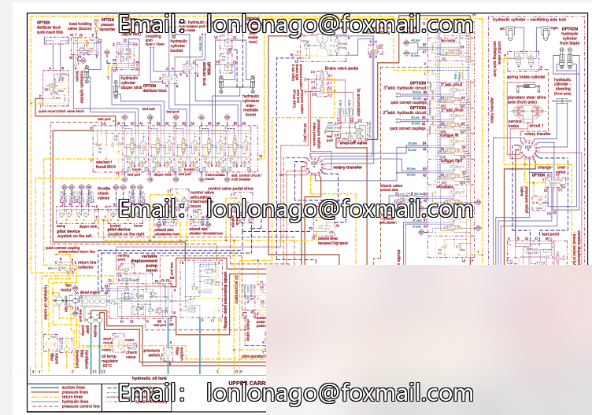
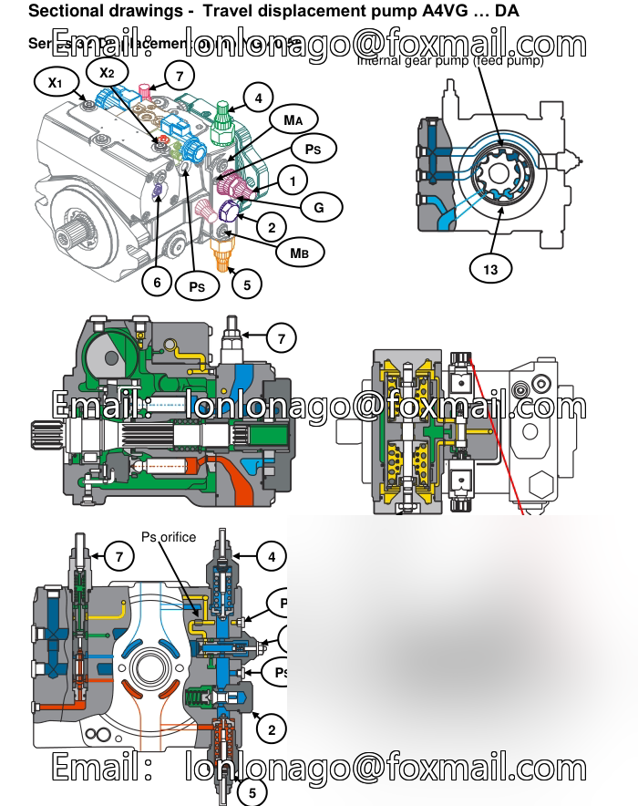

# Terrex (TEREX) TW85 T4i wheel excavator service manual

## Body

Teroux (TEREX) TW85 T4i wheeled excavator service manual, PDF , 200 pages, covering hydraulic system, electrical principles, maintenance and inspection, suitable for equipment repair and technical reference.

The service manual covers hydraulic systems, electrical principles, maintenance and maintenance, in PDF format with 200 pages, suitable for equipment repair and technical reference.

<!-- AI_ENRICHED -->

## Images

## Payment

Here is a pay link on Stripe ( https://buy.stripe.com/3cs8yP7sY87d0vu9AB ). Please contact me lonlonago@foxmail.com after funding $89, and I will send you a complete data files , thank you!

